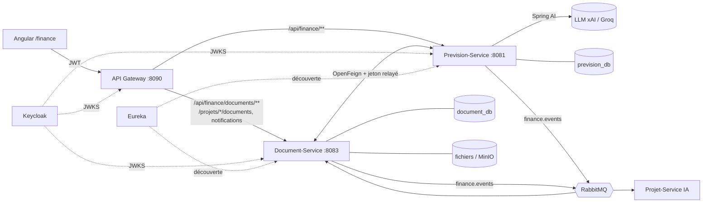

# Finance-Service — prévisions et documents financiers

Module **Finance** de LaunchPad AI : l'entrepreneur saisit les prévisions de son projet, obtient marges, écarts et
projections, génère des documents financiers (PDF / Excel). Un **financier** invité relit, valide ou rejette les
prévisions et **certifie** les documents avant leur envoi à un investisseur.

Le module est composé de **deux microservices Spring Boot**, chacun avec sa propre base PostgreSQL :

| Microservice | Port | Nom Eureka | Base | Responsabilité |
|---|---|---|---|---|
| **Prevision-Service** | 8081 | `PREVISION-SERVICE` | `prevision_db` | prévisions, marges, écarts, projections, rôles par projet, avis du financier, IA (Spring AI) |
| **Document-Service** | 8083 | `DOCUMENT-SERVICE` | `document_db` | génération des documents, export PDF / Excel, stockage (disque ou S3/MinIO), certification, notifications |

Contrat d'intégration détaillé (endpoints, formats, codes d'erreur, événements) : **[CONTRAT-API.md](CONTRAT-API.md)**.
Diagrammes (architecture, classes, séquences) : **[Documentation/Diagrams/Finance](../../Documentation/Diagrams/Finance/README.md)**.

---

## 1. Rôles et workflow

Le rôle Keycloak (`ENTREPRENEUR`, `FINANCIER`, `ADMIN`) ne suffit pas : chaque projet a ses **membres**, tenus par le
Prevision-Service (table `membre_projet`).

| Rôle sur le projet | Qui | Peut |
|---|---|---|
| **Propriétaire** | l'entrepreneur qui crée la première prévision (ou invite le premier financier) | saisir les prévisions, générer projections et documents, supprimer, inviter / retirer des financiers, assistant IA |
| **Financier invité** | un compte `FINANCIER` dont l'e-mail a été invité | tout consulter et exporter, commentaire IA de l'écart, **valider / rejeter** une prévision, **certifier** un document — ne modifie rien |
| **Admin** | rôle Keycloak `ADMIN` | tout |

Workflow complet :

```
Entrepreneur                          Financier invité
────────────                          ────────────────
1. choisit / crée son projet (Projet-Service)
2. saisit une prévision ──────────────► 3. notifié « attend votre avis »
                                        4. rejette (commentaire obligatoire)
5. notifié « rejetée : … » ◄────────────┘
6. corrige (nouvelles projections) ────► 7. notifié « a changé : nouvel avis »
                                        8. valide
9. génère le document ──────────────────► 10. certifie le document
11. notifié « certifié, prêt pour l'investisseur » ◄┘
```

Règles métier principales :

- **Rejet motivé** : un rejet exige un commentaire.
- **Avis invalidé par de nouveaux chiffres** : de nouvelles projections *différentes* remettent la prévision
  « en attente » ; régénérer les *mêmes* projections conserve l'avis (un rejet ne s'efface pas sans correction).
- **Certification fidèle** : un document se certifie une seule fois, seulement si sa prévision source est **validée**
  et que ses chiffres **n'ont pas changé** depuis la génération (empreinte SHA-256 des chiffres, comparée à la
  certification). Sinon : « regénérez le document ».
- **Isolation des projets** : un entrepreneur ne lit ni ne modifie le projet d'un autre (403).

## 2. Architecture



Organisation du code (identique dans les deux services, vérifiée par **ArchUnit** — `ArchitectureTest`) :

| Package | Rôle |
|---|---|
| `domain` | modèle métier en **Java pur** (records, règles) — aucune dépendance Spring / JPA |
| `service` | cas d'usage ; dépend de **ports** (interfaces), jamais des clients REST |
| `repository` + `entities` | persistance (patron **Adapter** : port → Spring Data JPA) ; migrations **Flyway** |
| `client` | adaptateurs **OpenFeign** vers l'autre service |
| `controller` + `dto` | API REST, validation Bean Validation, erreurs **ProblemDetail (RFC 7807)** |
| `config` | sécurité JWT, RabbitMQ, relais du jeton, IA, stockage |

Patrons utilisés : Adapter (persistance, clients distants), **Strategy** (projections `CroissanceParTaux`, exports
PDF / Excel), Ports & Adapters, événements applicatifs publiés après commit (`@TransactionalEventListener`).

## 3. Communication entre microservices

### Synchrone — OpenFeign (5 scénarios)

| # | Appelant → appelé | Requête | Quand |
|---|---|---|---|
| 1 | Document → Prevision | `GET /api/finance/projets/{id}/synthese` | génération d'un document (prévision, marges, écart, projections) |
| 2 | Document → Prevision | `POST /api/finance/ia/analyse` | document « avec analyse IA » |
| 3 | Document → Prevision | `GET /api/finance/projets/{id}/acces` | contrôle des droits avant chaque action sur un document |
| 4 | Document → Prevision | `GET /api/finance/previsions/{id}` | certification : statut et empreinte de la prévision |
| 5 | Prevision → Document | `POST /api/finance/documents` | l'assistant IA génère un document (appel d'outil du LLM) |

Résolution par **Eureka** (Spring Cloud LoadBalancer), timeouts courts (5 s ; 45 s pour l'IA), **jeton de
l'utilisateur relayé** (`RelaisJetonFeign`), service arrêté → **503** lisible au lieu d'un blocage.

### Asynchrone — RabbitMQ (4 scénarios)

Exchange **topic durable `finance.events`**, messages JSON persistants, publication **après commit**.

| # | Clé de routage | Producteur → consommateur(s) | Effet |
|---|---|---|---|
| 1 | `finance.prevision.a-valider` | Prevision → Document | notification au financier (création) ou à tout le projet (chiffres modifiés) |
| 2 | `finance.prevision.avis` | Prevision → Document | notification « validée / rejetée » au propriétaire |
| 3 | `finance.document.genere` | Document → Document **+ Projet-Service (IA)** | notification « document disponible » ; l'IA met à jour le diagnostic du projet |
| 4 | `finance.document.certifie` | Document → Document | notification « certifié, prêt pour l'investisseur » au propriétaire |

Consommation **idempotente** (clé de dédoublonnage par événement), 3 tentatives puis rejet, convertisseur JSON limité
au package `domain` (aucune classe arbitraire instanciée depuis un message).

## 4. Sécurité

- **JWT Keycloak** vérifié par la gateway **et** par chaque service (`spring-boot-starter-oauth2-resource-server`,
  clés `KEYCLOAK_JWK_SET_URI`), activé par `JWT_ENABLED=true` (docker-compose).
- **Contrôle par projet** (`ControleAcces`) : lecture / écriture / validation selon le rôle sur le projet → 403 sinon.
- Routes internes : `GET /projets/{id}/synthese` et `POST /ia/analyse` acceptent les appels internes sans jeton ;
  la gateway **refuse** `/api/finance/ia/**` (403) — l'IA payante n'est pas exposée.
- Le modèle IA ne peut agir que sur le projet de la requête (outils liés au projet côté serveur).

## 5. Lancer le module

**Avec toute la plateforme (recommandé)** — depuis la racine du dépôt : `docker compose up -d --build`
(PostgreSQL, RabbitMQ, Keycloak, Eureka, gateway et front compris). Voir le [README racine](../../README.md).

**Seul, en local** (PostgreSQL et RabbitMQ locaux, bases `prevision_db` / `document_db`) :

```bash
cd Backend/Finance-Service
mvn -pl Prevision-Service spring-boot:run     # :8081
mvn -pl Document-Service spring-boot:run      # :8083
```

| Variable | Défaut | Rôle |
|---|---|---|
| `DB_URL`, `DB_USERNAME`, `DB_PASSWORD` | base locale du service | PostgreSQL |
| `RABBITMQ_HOST`, `RABBITMQ_USERNAME`, `RABBITMQ_PASSWORD` | `localhost`, `guest` | broker |
| `JWT_ENABLED` / `KEYCLOAK_JWK_SET_URI` | `false` / Keycloak local | sécurité (désactivée = tout ouvert, développement) |
| `EUREKA_CLIENT_ENABLED`, `PREVISION_SERVICE_URL`, `DOCUMENT_SERVICE_URL` | Eureka actif | sans Eureka : adresse directe de l'autre service |
| `SPRING_AI_MODEL_CHAT`, `XAI_API_KEY`, `XAI_BASE_URL`, `XAI_MODEL` | IA désactivée | IA (xAI ou Groq, API compatible OpenAI) |
| `STOCKAGE_*` | disque local (profil dev) | stockage objet S3 / MinIO des exports |

**Swagger** (via la gateway) : http://localhost:8090/docs/finance/prevision/swagger-ui/index.html et
http://localhost:8090/docs/finance/document/swagger-ui/index.html — ou directement
http://localhost:8081/swagger-ui.html et http://localhost:8083/swagger-ui.html.

## 6. Tests

```bash
cd Backend/Finance-Service
mvn test          # environ 250 tests sur les deux services
```

| Niveau | Exemples |
|---|---|
| Domaine (unitaires) | règles de validation, empreinte des chiffres, droits par rôle |
| Services (Mockito) | contrôle d'accès, avis, certification, événements publiés |
| Web (`@WebMvcTest`) | contrôleurs, ProblemDetail, sécurité JWT active (`spring-security-test`) |
| Feign | vrai serveur HTTP local : réponses, 404, 503, service éteint |
| RabbitMQ | publication sur `finance.events`, JSON lu depuis un autre langage, dédoublonnage |
| Intégration | **Testcontainers** (PostgreSQL réel, migrations Flyway, MinIO) |
| Architecture | **ArchUnit** : dépendances interdites entre packages |

Les tests Testcontainers nécessitent Docker. Les tests IA (`IaConfigTest`) supposent que `SPRING_AI_MODEL_CHAT` /
`XAI_*` ne sont **pas** définis dans l'environnement.

## 7. Limites connues

- Notifications gardées **en mémoire** (50 dernières) : perdues au redémarrage du Document-Service.
- Un événement est perdu si RabbitMQ est arrêté au moment de la publication (pas de patron Outbox) ; pas de file
  de messages en échec (DLQ).
- Les membres d'un projet sont tenus par Finance : le Projet-Service ne relie pas encore `entrepreneur_id` à
  l'identifiant Keycloak.
