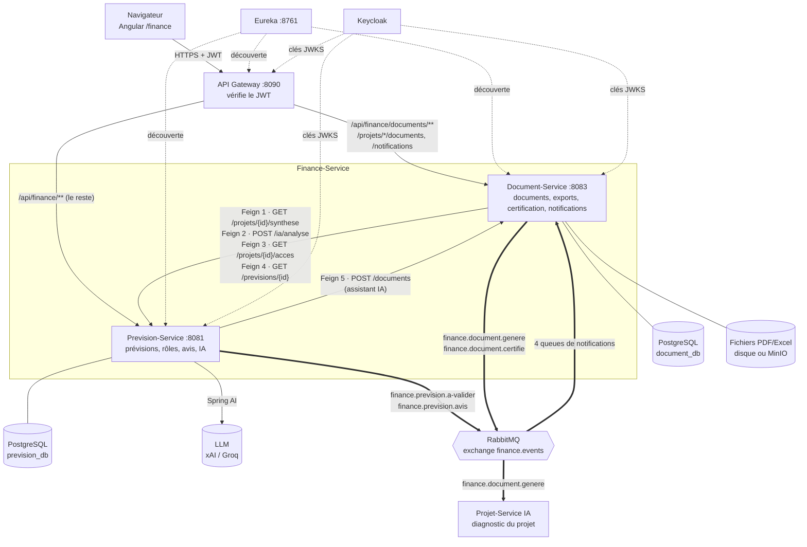

# Architecture et communication — module Finance

Traits pleins : appels HTTP **synchrones** (gateway, OpenFeign). Traits épais : messages **asynchrones** RabbitMQ
(exchange topic `finance.events`). Pointillés : découverte (Eureka) et clés de vérification des JWT (Keycloak).

## Points de conception

- **Une base par service** : aucune clé étrangère entre `prevision_db` et `document_db` ; le projet n'est référencé que
  par son identifiant (`projetId`, celui du Projet-Service).
- **Jeton relayé** : sur les appels Feign, le JWT de l'utilisateur est transmis ; le service appelé applique les droits
  de ce même utilisateur.
- **Panne d'un service** : timeouts courts, réponse 503 lisible ; les documents déjà générés restent consultables.
- **Messages** : JSON lisible par un service non Java (le Projet-Service est en Python), publication après commit,
  traitement idempotent.
