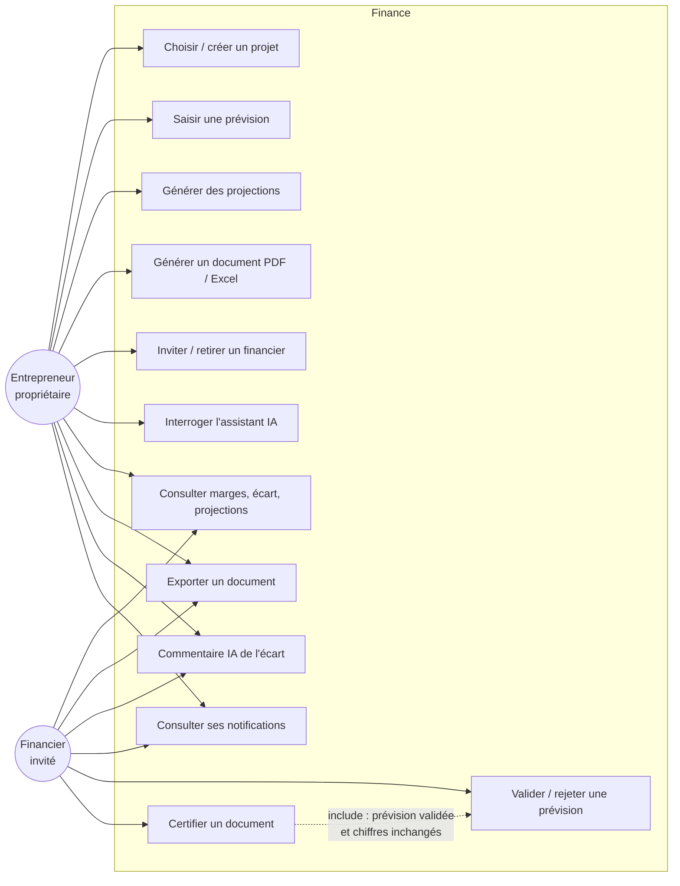

# Cas d'utilisation — module Finance

Deux rôles sur un même projet : l'**entrepreneur** (propriétaire, produit les données) et le **financier invité**
(relecteur, valide). Un administrateur a tous les droits.

| Cas | Entrepreneur | Financier |
|---|:-:|:-:|
| Saisir prévisions, projections, documents ; inviter ; assistant IA | ✅ | ❌ (403) |
| Consulter, exporter, commentaire IA, notifications | ✅ | ✅ |
| Valider / rejeter une prévision, certifier un document | ❌ (403) | ✅ |
