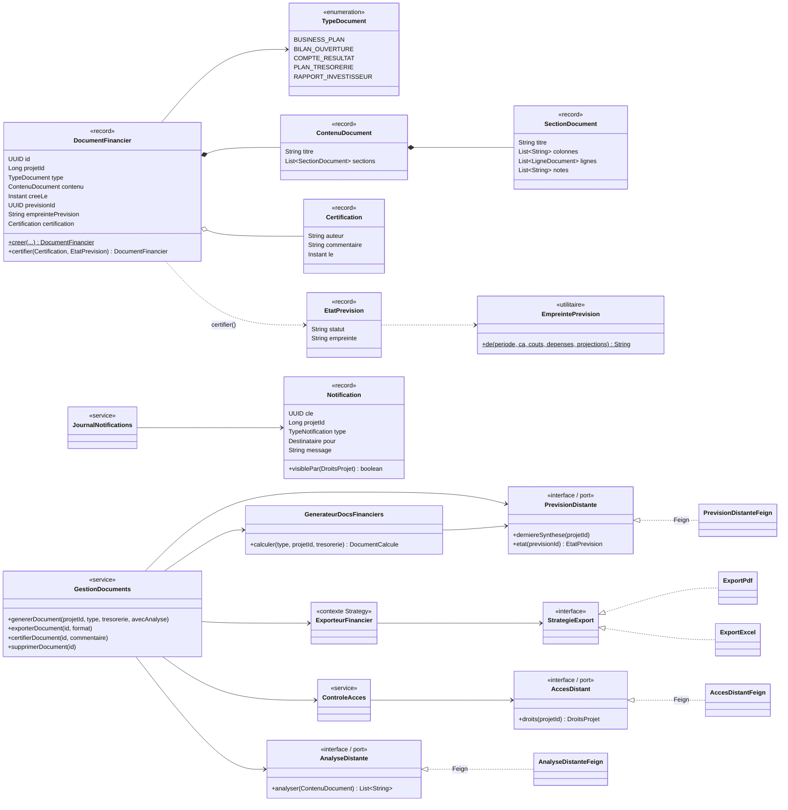

# Diagramme de classes — Document-Service

Les trois ports `PrevisionDistante`, `AccesDistant` et `AnalyseDistante` sont implémentés par des adaptateurs
**OpenFeign** (package `client`) ; les services métier ne dépendent que des interfaces (règle ArchUnit).
