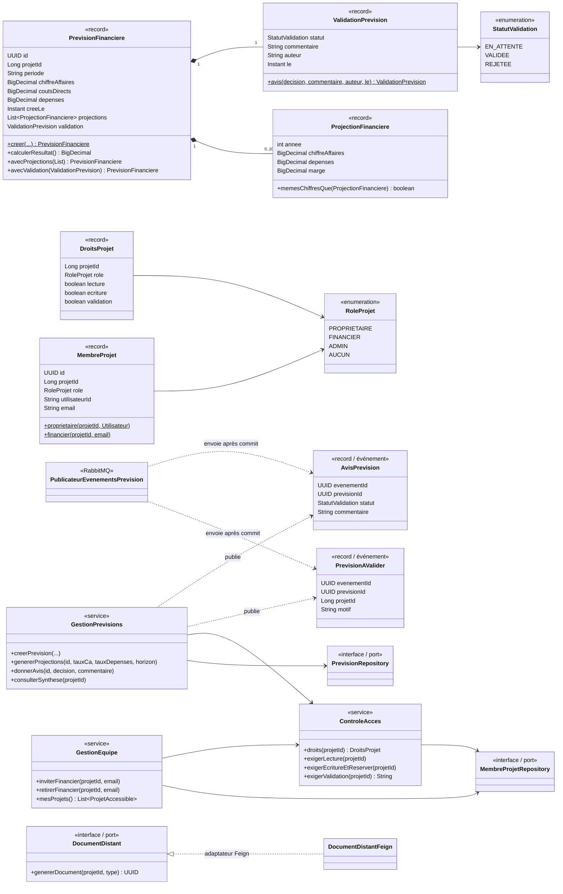

# Diagramme de classes — Prevision-Service

Modèle métier (`domain`, Java pur), cas d'usage (`service`) et ports de persistance (`repository`). Les entités JPA
(`entities`) ne sont manipulées que par les adaptateurs `*RepositoryJpa` (règle vérifiée par ArchUnit).

Le `ModelePrevisionnel` calcule les projections via une `StrategieProjection` (patron **Strategy**, implémentation
`CroissanceParTaux`). L'IA (`AssistantFinancier`, `CommentateurEcart`, `RedacteurIA`) passe par le port `ClientLLM`.
