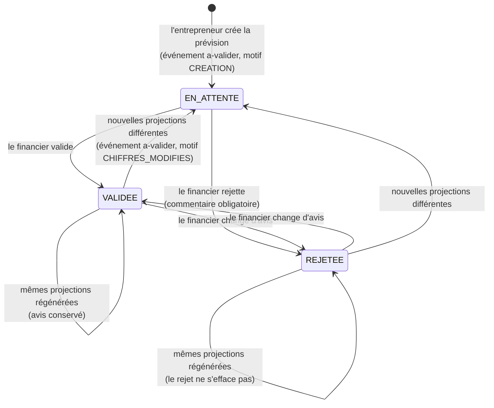

# États d'une prévision

Un document ne peut être **certifié** que si la prévision dont il est tiré est `VALIDEE` **et** que ses chiffres sont
identiques à ceux utilisés à la génération du document.
