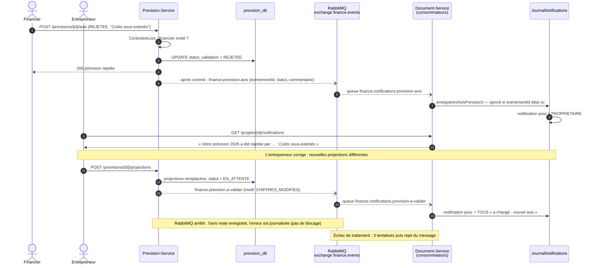

# Séquence — avis du financier et notifications (communication asynchrone, RabbitMQ)

Le Prevision-Service publie ses événements **après le commit** de la transaction sur l'exchange topic
`finance.events` ; le Document-Service les consomme (une queue par type) et produit les notifications, filtrées
ensuite selon le rôle de l'utilisateur sur le projet.

