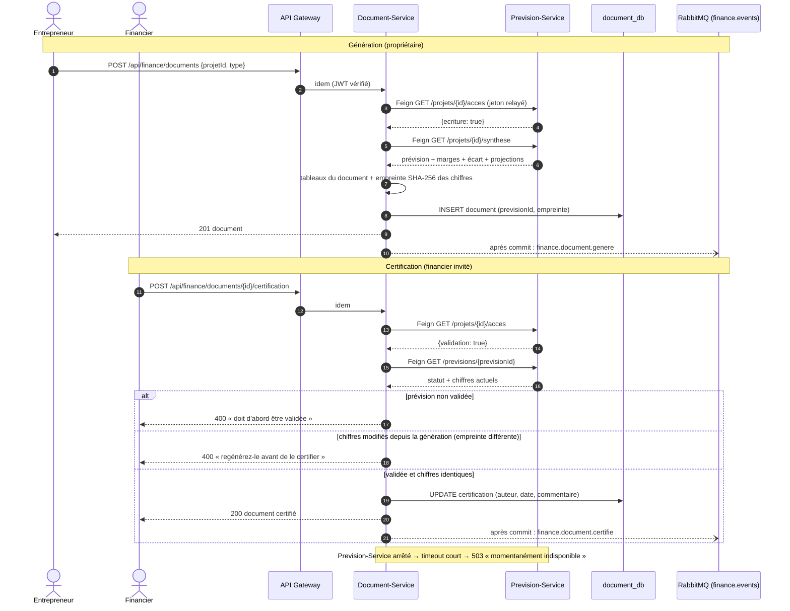

# Séquence — génération puis certification d'un document (communication synchrone, OpenFeign)

Le Document-Service appelle trois fois le Prevision-Service par **OpenFeign**, en relayant le jeton de l'utilisateur :
droits sur le projet, synthèse de la prévision (génération), état de la prévision (certification).

