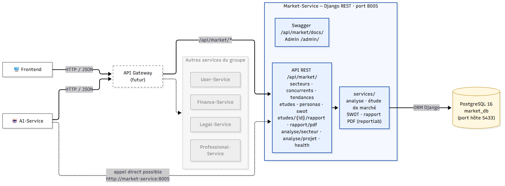
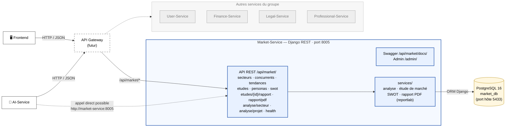

# Architecture — Market-Service dans LaunchPad AI

Vue d'ensemble de la place du Market-Service dans l'architecture microservices du projet.
Les services en gris sont ceux des autres membres du groupe (contexte uniquement).

## À retenir

- Le Market-Service possède **sa propre base PostgreSQL** (`market_db`) : aucun autre service n'y accède
  directement, tout passe par l'API REST.
- Les projets et les entrepreneurs sont gérés ailleurs : le Market-Service ne stocke que `projet_id` et
  `entrepreneur_id` (sans clé étrangère).
- Le rapport d'étude de marché est produit en JSON et en PDF (reportlab) par le service lui-même :
  aucun service externe n'est nécessaire.
- En Docker, PostgreSQL écoute sur 5432 dans le réseau interne et est exposé sur **5433** côté machine.
