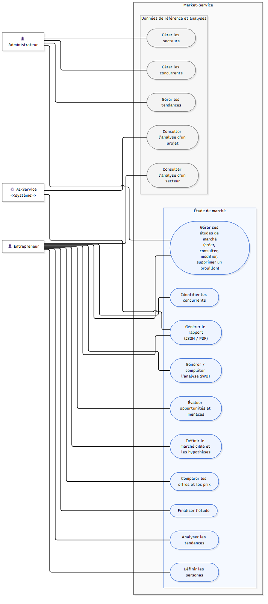
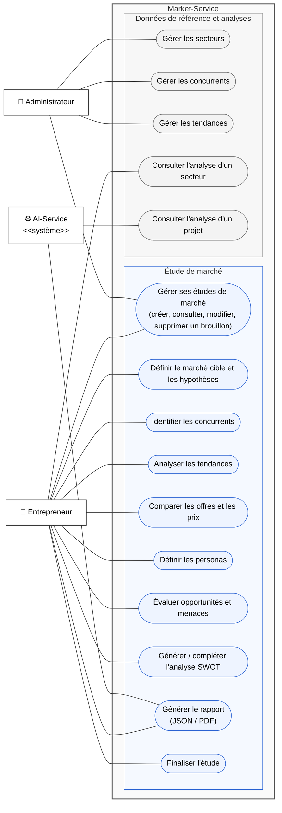

# Diagramme de cas d'utilisation — Market-Service

Mermaid n'a pas de diagramme de cas d'utilisation natif : la version ci-dessous est un `flowchart`
mis en forme comme un diagramme UML. La version UML standard est dans
[diagramme-cas-utilisation.puml](diagramme-cas-utilisation.puml) (PlantUML).

## Correspondance avec l'API

| Cas d'utilisation | Endpoints |
|---|---|
| Gérer ses études de marché | `GET/POST /api/market/etudes/` (filtres `?entrepreneur_id=`, `?statut=`, `?projet_id=`), `GET/PATCH/DELETE /api/market/etudes/{id}/` |
| Définir le marché cible et les hypothèses | `PATCH /api/market/etudes/{id}/` (`secteur`, `cible`, `zone_geographique`, `taille_marche`, `taux_croissance`, `hypotheses`) |
| Identifier les concurrents | champ `concurrents` (IDs) de l'étude |
| Analyser les tendances | champ `tendances` (IDs) de l'étude, `GET /api/market/tendances/` |
| Comparer les offres et les prix | `GET /api/market/etudes/{id}/comparaison-prix/` |
| Définir les personas | CRUD `/api/market/personas/` (`?etude=`) |
| Évaluer opportunités et menaces | `GET /api/market/etudes/{id}/opportunites-menaces/` |
| Générer / compléter l'analyse SWOT | `POST /api/market/etudes/{id}/generer-swot/`, CRUD `/api/market/swot/` |
| Générer le rapport | `GET /api/market/etudes/{id}/rapport/` et `/rapport/pdf/` |
| Finaliser l'étude | `POST /api/market/etudes/{id}/finaliser/` |
| Gérer les secteurs / concurrents / tendances | `/api/market/secteurs/`, `/api/market/concurrents/`, `/api/market/tendances/` |
| Consulter l'analyse d'un secteur | `GET /api/market/analyse/secteur/{secteur_id}/` |
| Consulter l'analyse d'un projet | `GET /api/market/analyse/projet/{projet_id}/` |

« Gérer » regroupe lister, consulter, créer, modifier et supprimer (CRUD). L'Administrateur peut aussi
le faire depuis l'admin Django (`/admin/`), où personas et SWOT s'éditent directement dans la fiche de l'étude.

> Remarque : la répartition des rôles est celle **prévue** ; le code actuel n'applique pas encore
> de contrôle d'accès (aucune authentification configurée dans DRF). Elle sera assurée par la future
> API Gateway / le User-Service (`entrepreneur_id` identifie déjà le propriétaire d'une étude).
