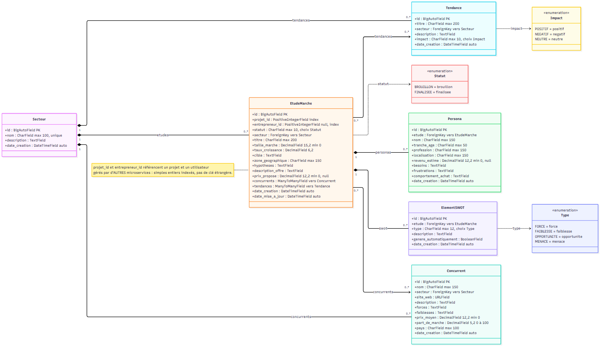
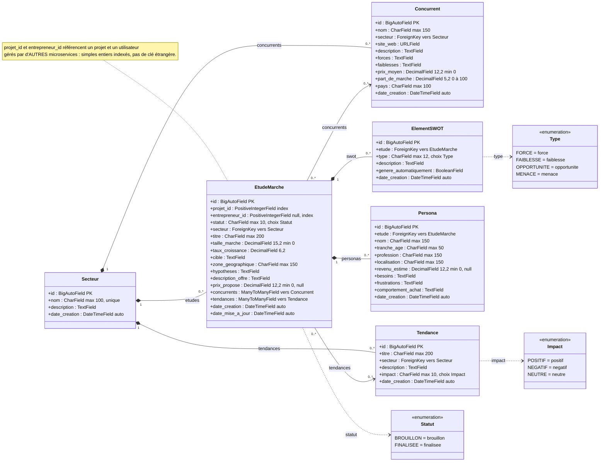

# Diagramme de classes — Market-Service

Modèles Django de l'application `marche` (`Backend/Market-Service/marche/models.py`).
Toutes les clés étrangères utilisent `on_delete=CASCADE`, d'où les compositions : supprimer un secteur
supprime ses concurrents, études et tendances ; supprimer une étude supprime ses personas et sa SWOT.
Les liens ManyToMany étude ↔ concurrents / tendances sont de simples associations : supprimer une étude
ne supprime ni les concurrents ni les tendances.

## Points clés

| Modèle | Rôle | Tri par défaut |
|---|---|---|
| `Secteur` | Secteur d'activité (FinTech, EdTech…) | `nom` |
| `Concurrent` | Acteur présent dans un secteur | `-part_de_marche`, `nom` |
| `EtudeMarche` | Étude de marché d'un entrepreneur pour un projet : marché cible, hypothèses, offre et prix | `-date_creation` |
| `Tendance` | Tendance observée dans un secteur, avec un impact | `-date_creation` |
| `Persona` | Client type visé par l'offre d'une étude | `id` |
| `ElementSWOT` | Élément de la SWOT d'une étude, saisi à la main ou généré | `type`, `id` |

- Validations portées par le modèle (et reprises par les `ModelSerializer`) :
  `prix_moyen ≥ 0`, `0 ≤ part_de_marche ≤ 100`, `taille_marche ≥ 0`, `prix_propose ≥ 0`, `revenu_estime ≥ 0`.
- `taux_croissance` peut être négatif (marché en recul).
- `genere_automatiquement = true` : élément créé par `POST /etudes/<id>/generer-swot/`, remplacé à chaque
  génération ; les éléments manuels (`false`) sont conservés.
