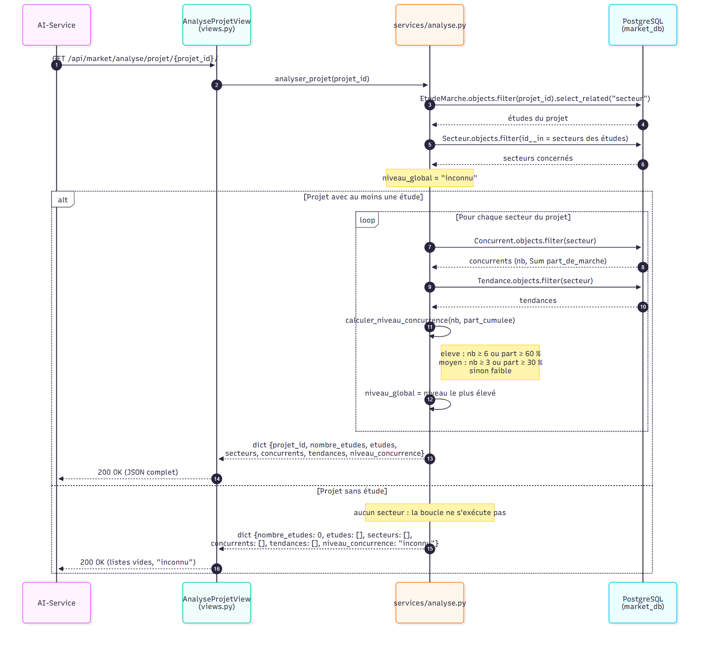
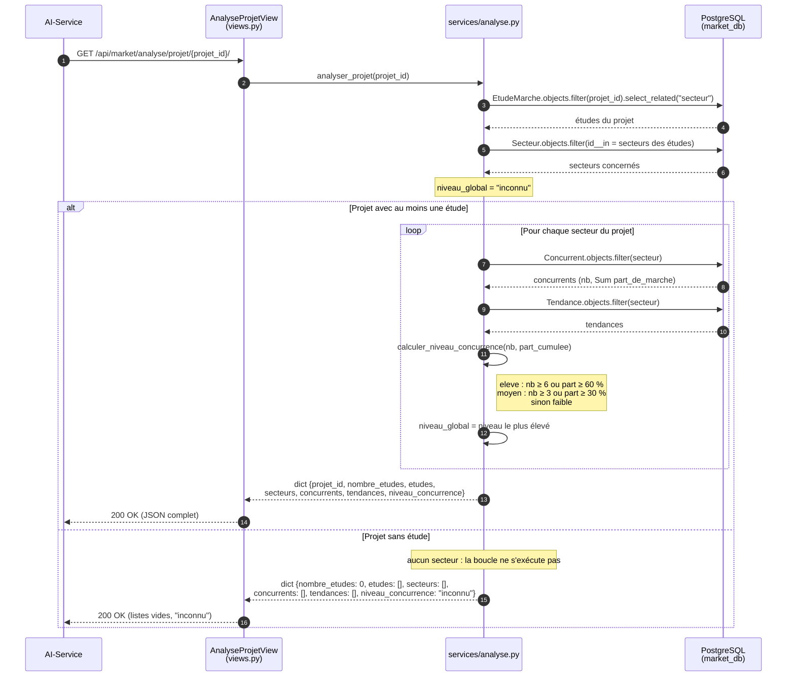

# Diagramme de séquence — Analyse du marché d'un projet

Appel du AI-Service vers `GET /api/market/analyse/projet/<projet_id>/`
(`AnalyseProjetView` → `services.analyser_projet`, dans `marche/services/analyse.py`).

## À retenir

- Un projet sans étude **n'est pas une erreur** : la réponse est toujours `200`, ce qui simplifie
  le traitement côté AI-Service (pas de `404` à gérer).
- Le niveau de concurrence global du projet est le **maximum** des niveaux de ses secteurs,
  selon l'ordre `inconnu < faible < moyen < eleve`.
