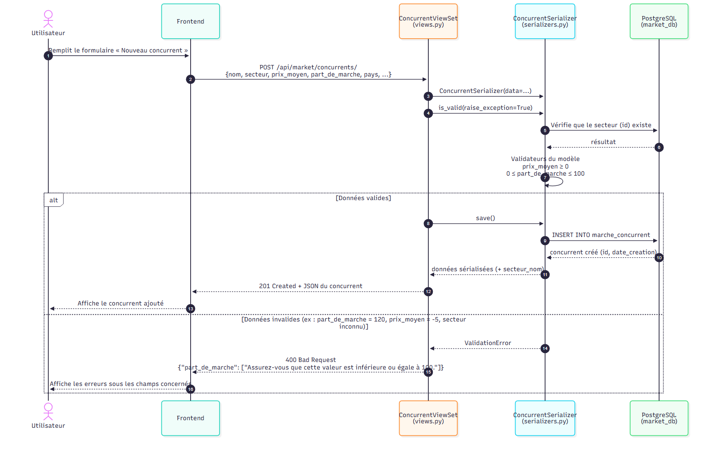
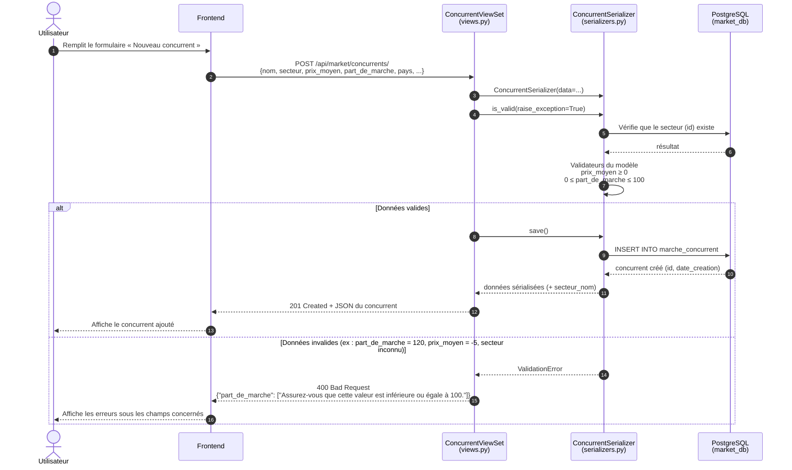

# Diagramme de séquence — Création d'un concurrent

Le Frontend appelle `POST /api/market/concurrents/` (`ConcurrentViewSet.create`, `ConcurrentSerializer`).

## À retenir

- Les règles de validation sont déclarées **une seule fois** dans le modèle
  (`MinValueValidator`, `MaxValueValidator`) et appliquées automatiquement par le `ModelSerializer`.
- En cas d'erreur, rien n'est écrit en base et l'API renvoie `400` avec un message par champ invalide.
