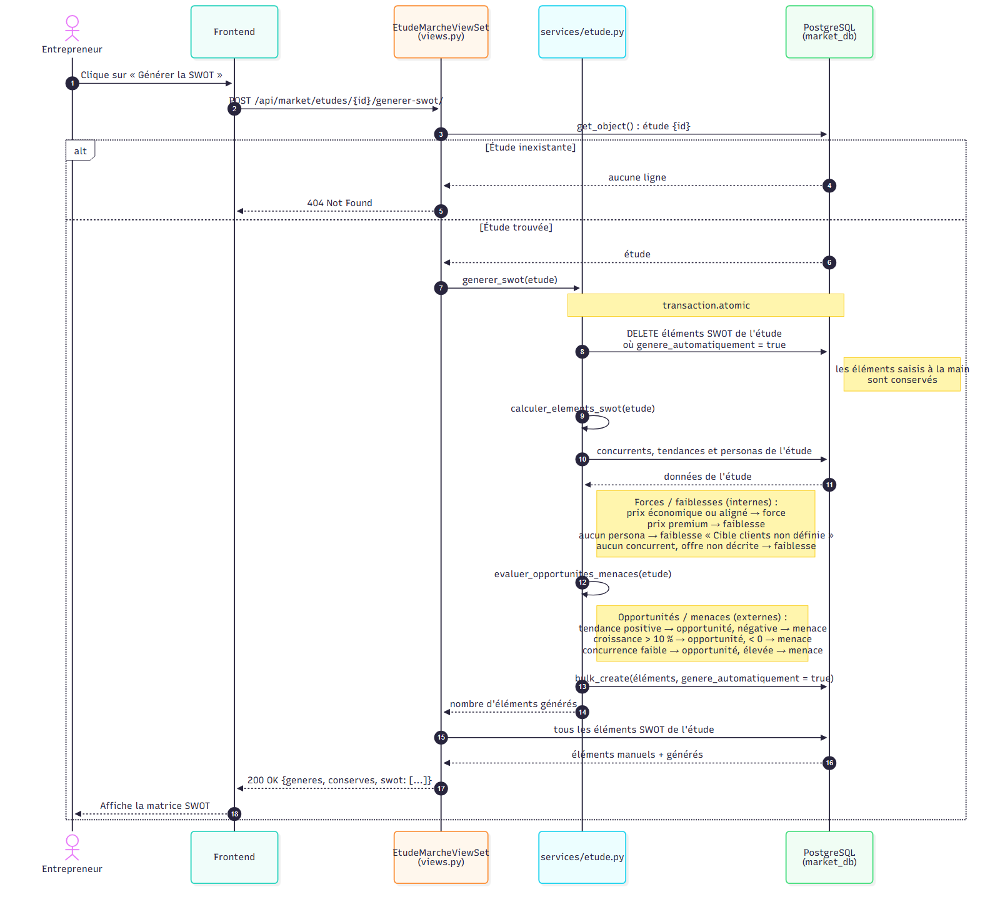
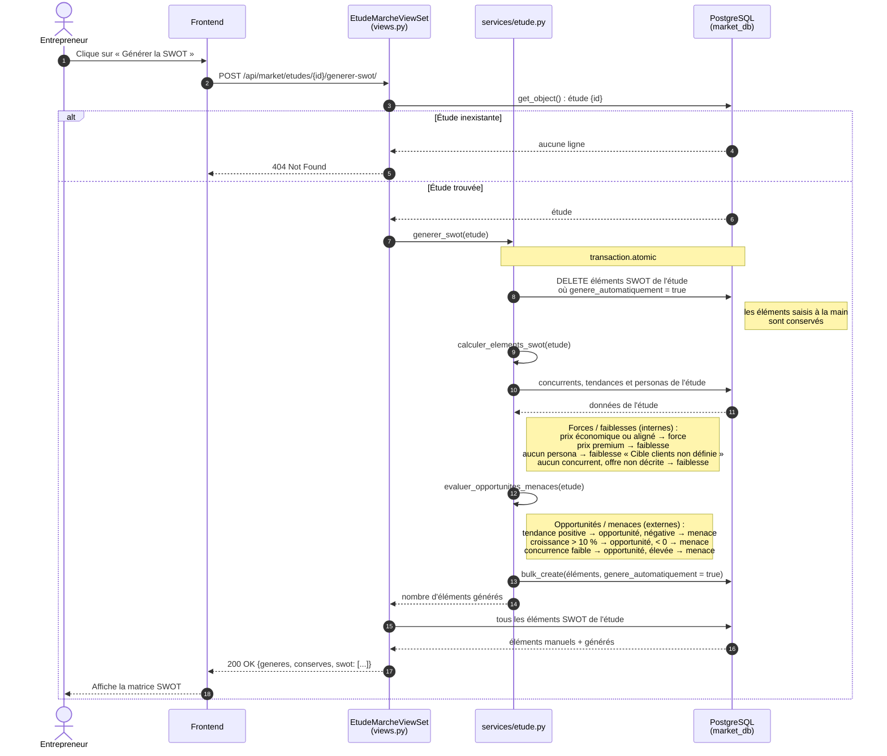

# Diagramme de séquence — Génération de la SWOT d'une étude

L'entrepreneur demande la SWOT automatique de son étude : `POST /api/market/etudes/<id>/generer-swot/`
(`EtudeMarcheViewSet.generer_swot` → `services.generer_swot`, dans `marche/services/etude.py`).

## À retenir

- La génération est **rejouable** : chaque appel remplace uniquement les éléments générés automatiquement,
  sans doublon, et ne touche jamais aux éléments saisis à la main.
- Les règles sont simples et explicables (pas d'IA) : elles s'appuient sur les concurrents, tendances
  et personas que l'entrepreneur a associés à son étude.
