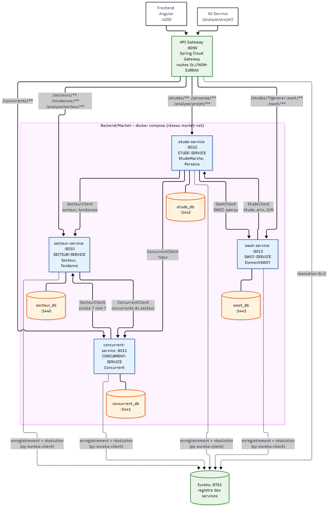
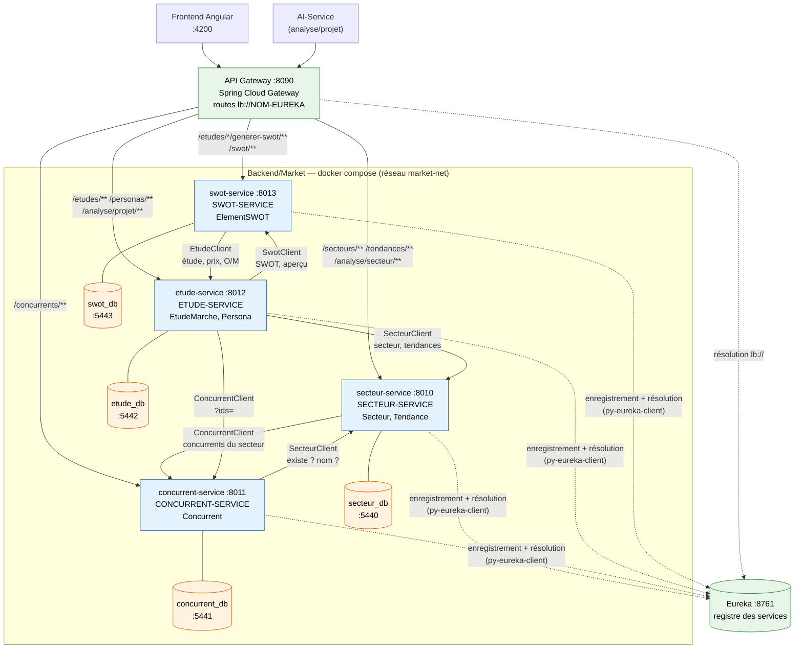

# Architecture — Étude de marché en 4 microservices

Les 4 services Django de `Backend/Market/` : chacun a sa base PostgreSQL, s'enregistre dans
Eureka et appelle les autres services par leur **nom Eureka** (package `clients/`).
L'API Gateway route les URLs publiques `/api/market/...` vers le bon service.

## À retenir

- **Une base par service** : aucune table partagée, aucune clé étrangère entre services.
- Les flèches pleines entre services sont des **appels REST** : l'adresse est lue dans Eureka
  par le nom du service (repli sur `<NOM>_SERVICE_URL`), timeout 3 s, une nouvelle tentative.
- Service appelé arrêté → `503 {"service": "<NOM>", "message": "Service indisponible"}`.
