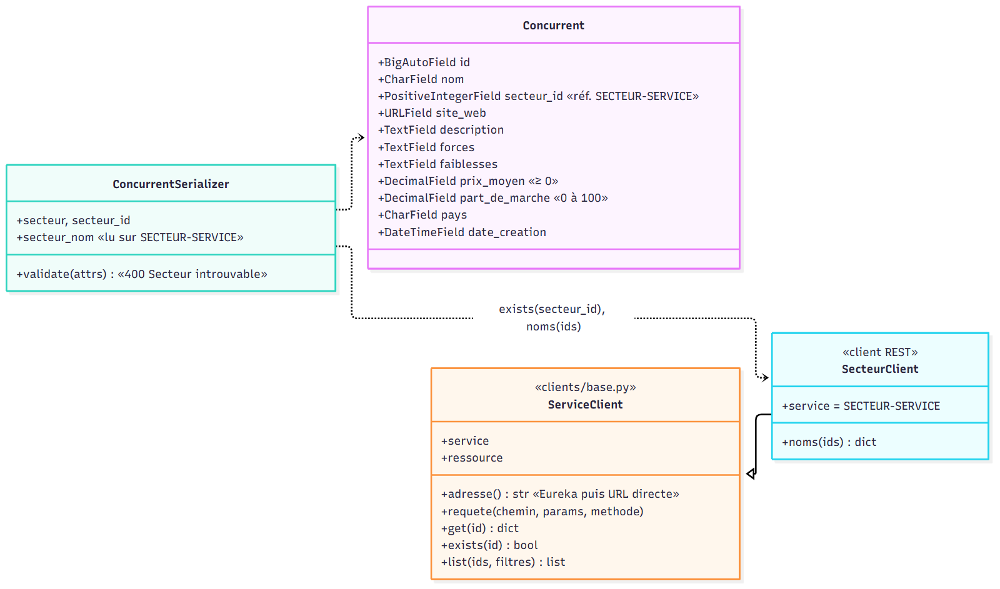
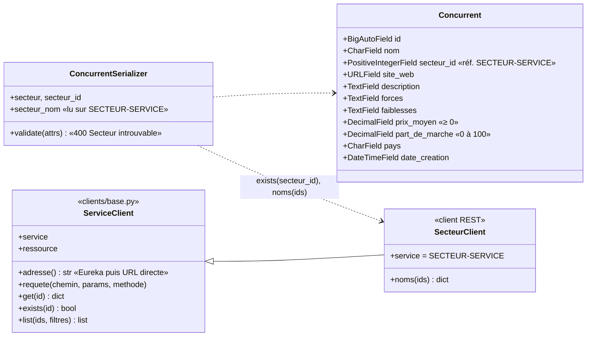

# Diagramme de classes — concurrent-service

Base `concurrent_db`. Le secteur n'est plus une clé étrangère : `secteur_id` est un entier
vérifié par `SecteurClient` (appel REST à SECTEUR-SERVICE).

