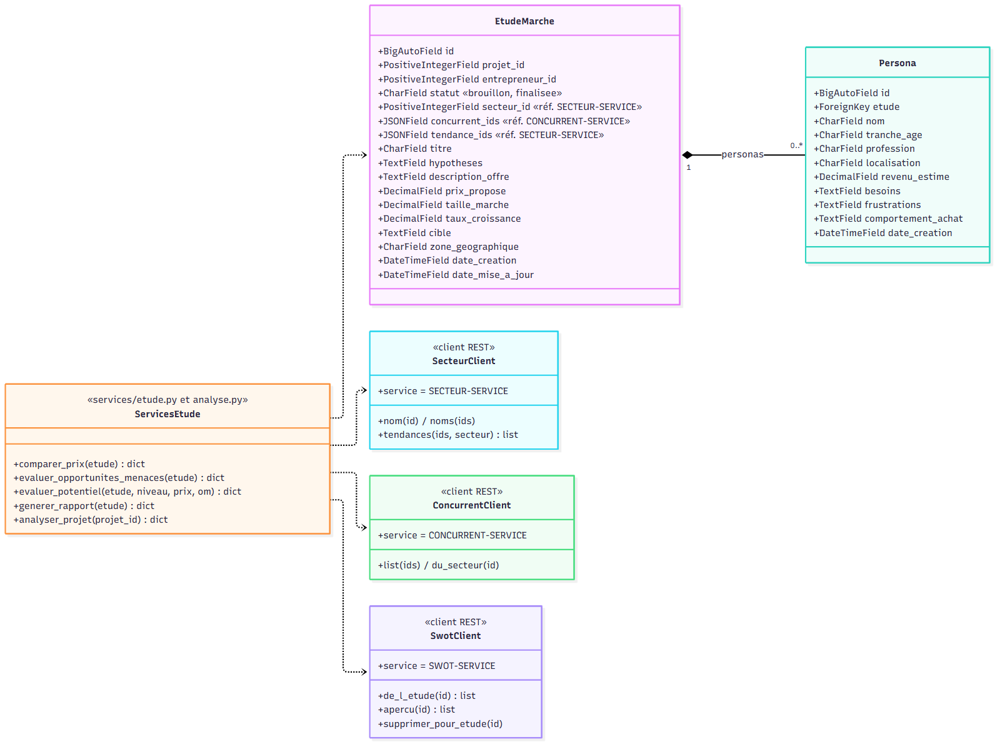
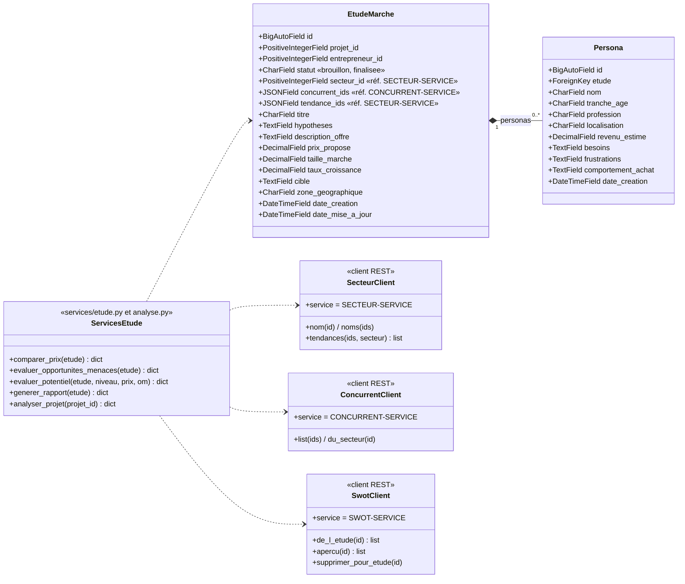

# Diagramme de classes — etude-service

Base `etude_db`. `Persona` garde une clé étrangère vers `EtudeMarche` (même service). Le secteur,
les concurrents et les tendances sont des **identifiants** vérifiés et lus par appels REST.

