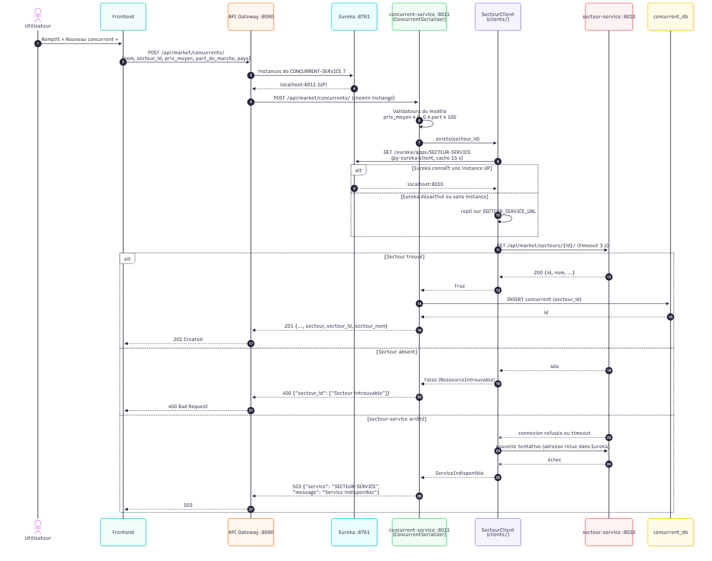
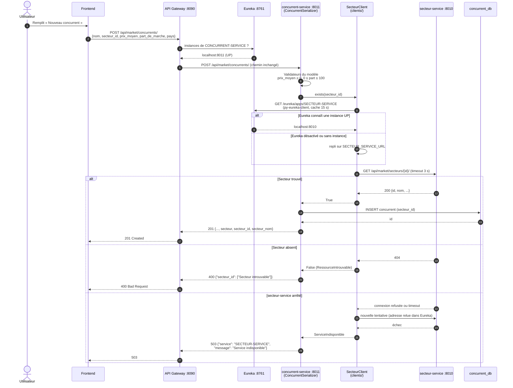

# Diagramme de séquence — Création d'un concurrent avec vérification du secteur via Eureka

`POST /api/market/concurrents/` : la gateway trouve CONCURRENT-SERVICE dans Eureka, puis
concurrent-service trouve SECTEUR-SERVICE dans Eureka pour vérifier que le secteur existe.

## À retenir

- Deux découvertes Eureka : la gateway trouve le concurrent-service, puis le concurrent-service
  trouve le secteur-service. Aucune adresse n'est écrite en dur (sauf l'URL de repli).
- Rien n'est écrit en base tant que le secteur n'a pas été confirmé par SECTEUR-SERVICE.
