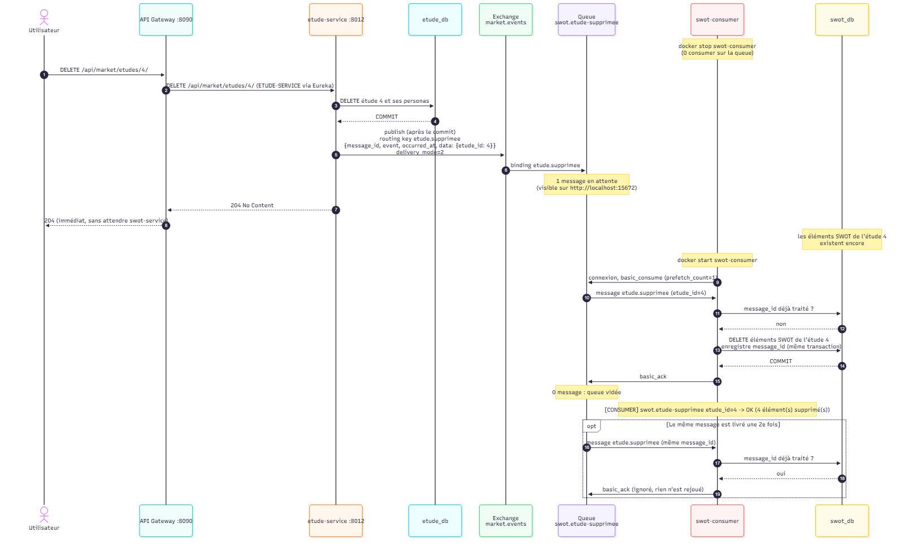
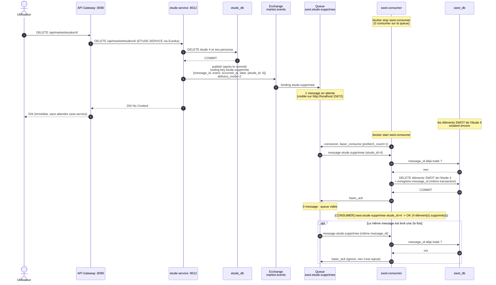

# Diagramme de séquence — Suppression d'une étude avec swot-consumer arrêté

L'étude est supprimée immédiatement ; l'événement `etude.supprimee` attend dans la queue
durable tant que swot-consumer est arrêté, puis il est traité à son redémarrage.

## À retenir

- La suppression d'une étude ne dépend plus de swot-service (avant : appel REST synchrone).
- Le message est **persistant** et la queue **durable** : il n'est pas perdu tant qu'il n'est pas acquitté.
- L'ack n'est envoyé qu'**après** le commit du traitement : un consumer qui tombe en plein
  traitement laisse le message dans la queue.
