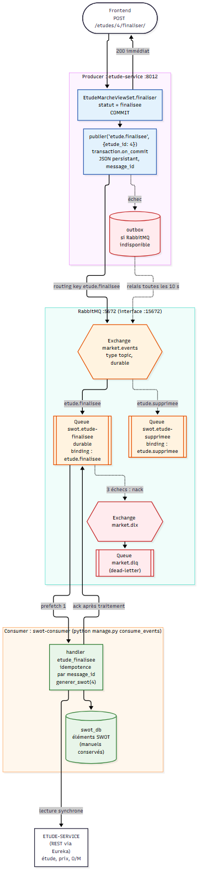
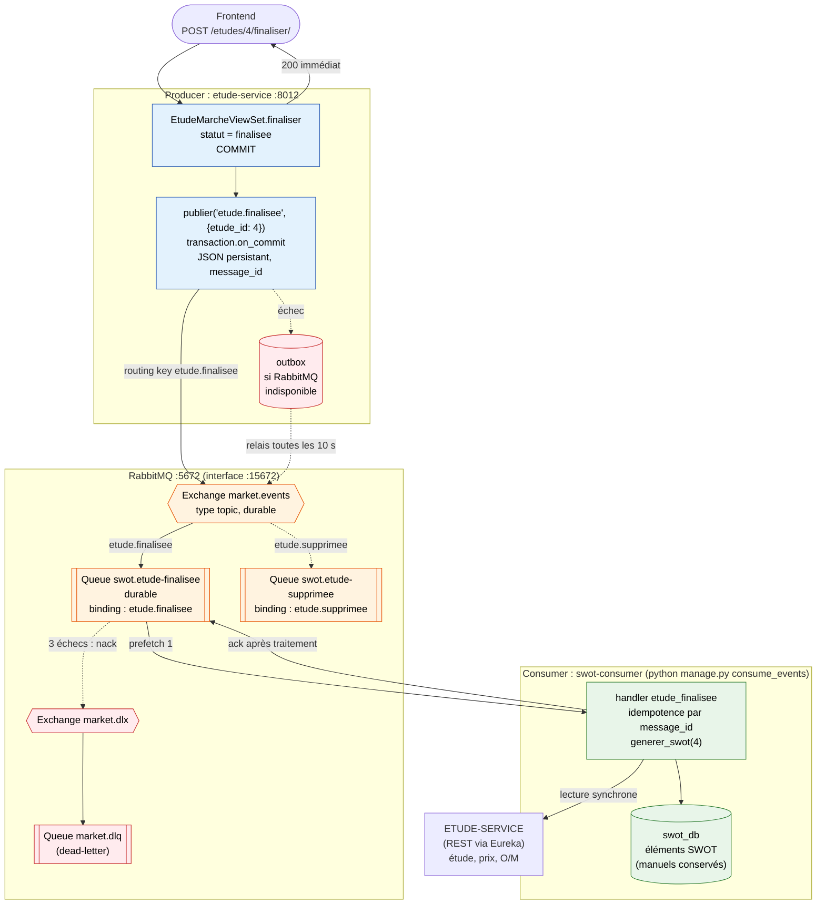

# Flux RabbitMQ — événement etude.finalisee

Producer → Exchange → Queue → Consumer : la finalisation d'une étude déclenche la génération
automatique de sa SWOT, sans que l'utilisateur attende swot-service.

## À retenir

- Le producer publie **sur l'exchange** avec la routing key `etude.finalisee` ; c'est le
  binding de la queue `swot.etude-finalisee` qui y amène le message.
- La réponse HTTP (200) n'attend pas la génération : la SWOT apparaît quelques secondes plus tard.
- Échec de traitement : 3 tentatives, puis `market.dlq`. RabbitMQ arrêté : outbox, renvoi automatique.
