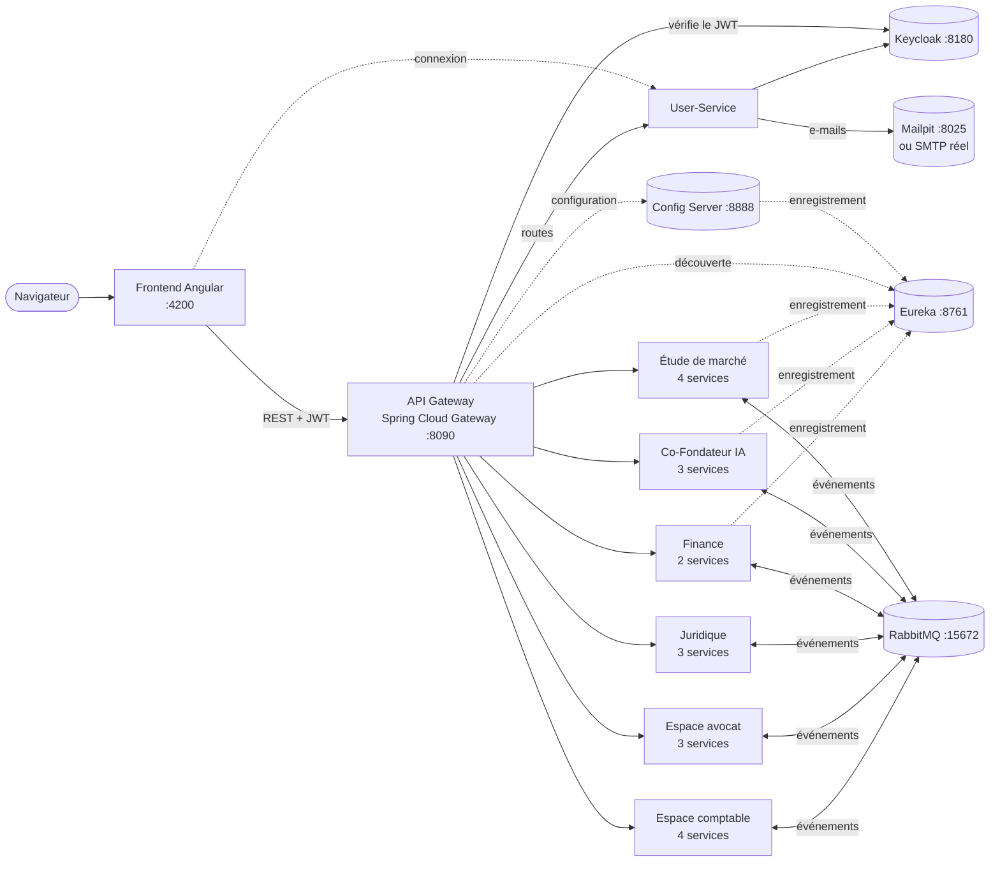

# LaunchPad AI

Plateforme d'accompagnement des startups en **architecture microservices** : un entrepreneur y
étudie son marché, construit ses prévisions financières, prépare ses documents juridiques,
échange avec un avocat ou un comptable, et se fait conseiller par un **Co-Fondateur IA**.

Tout se lance avec **un seul `docker compose`** : bases de données, Keycloak, Eureka, RabbitMQ,
API Gateway, une vingtaine de microservices (Spring Boot, Django, NestJS, Symfony) et le front Angular.

---

## Sommaire

1. [Architecture](#1-architecture)
2. [Modules et microservices](#2-modules-et-microservices)
3. [Démarrage rapide](#3-démarrage-rapide)
4. [Accès et comptes de démo](#4-accès-et-comptes-de-démo)
5. [Sécurité](#5-sécurité)
6. [Communication entre microservices](#6-communication-entre-microservices)
7. [Configuration (`.env`)](#7-configuration-env)
8. [Tests](#8-tests)
9. [Structure du dépôt et documentation détaillée](#9-structure-du-dépôt-et-documentation-détaillée)
10. [Dépannage](#10-dépannage)
11. [Règles Git](#11-règles-git)

---

## 1. Architecture



- **Un seul point d'entrée** : l'API Gateway (`http://localhost:8090`). Le front n'appelle qu'elle.
- **Découverte de services** : chaque microservice s'enregistre dans **Eureka** ; la gateway et les
  services s'appellent par leur nom (ex. `ETUDE-SERVICE`), sans adresse en dur.
- **Configuration centralisée** : le **Config Server** (Spring Cloud Config) sert la configuration
  depuis `Backend/Config-Server/config-repo/` ; la gateway la lit au démarrage.
- **Une base par microservice** (PostgreSQL ou MariaDB), jamais partagée.
- **Synchrone** (REST via Eureka / OpenFeign) pour lire des données d'un autre service,
  **asynchrone** (RabbitMQ) pour réagir aux événements.
- **Keycloak** est la source de vérité pour l'authentification (comptes, mots de passe, rôles).

---

## 2. Modules et microservices

| Module (front) | Microservices | Technologie | Base | Préfixe d'API (gateway) |
|---|---|---|---|---|
| **Authentification** (`/connexion`) | `user-service` (+ `keycloak-init`) | Django REST + Keycloak | PostgreSQL | `/api/auth/**` |
| **Étude de marché** (`/etude-marche`) | `secteur-service`, `concurrent-service`, `etude-service`, `swot-service` (+ 3 consumers) | Django REST, bibliothèque partagée `market-commun` | PostgreSQL ×4 | `/api/market/**` |
| **Co-Fondateur IA** (`/co-fondateur-ia`) | `projet-service`, `recommandation-service`, `conversation-service` (+ 2 consumers) | Django REST + LLM (Groq / OpenAI compatible) | PostgreSQL ×3 | `/api/ai/**` |
| **Finance** (`/finance`) | `prevision-service`, `document-service` | Spring Boot (OpenFeign, Spring Security) | PostgreSQL ×2 | `/api/finance/**` |
| **Juridique** (`/juridique`) | `legal-service`, `clause-service`, `commentaire-service` | NestJS + TypeORM | PostgreSQL ×3 | `/api/legal/**`, `/api/clauses/**`, `/api/commentaires/**` |
| **Espace avocat** (`/professional/avocat`) | `lawyer-client-service`, `lawyer-message-service`, `lawyer-docreview-service` | Spring Boot (OpenFeign) | PostgreSQL ×3 | `/api/lawyer/**` |
| **Espace comptable** (`/professional/comptabilite`) | `workspace-service`, `client-file-service`, `accounting-document-service`, `accounting-message-service` (+ consumers) | Symfony (PHP 8.4) | MariaDB | `/api/comptable/**` |

**Infrastructure**

| Composant | Rôle | Technologie |
|---|---|---|
| `api-gateway` | Point d'entrée unique, routage, vérification du JWT, rôles, CORS | Spring Cloud Gateway |
| `eureka` | Annuaire des services (découverte) | Spring Cloud Netflix Eureka |
| `config-server` | Configuration centralisée (fichiers de `config-repo/`, profil `native`) | Spring Cloud Config Server |
| `keycloak` + `keycloak-db` | Comptes, mots de passe, rôles du realm `launchpad` | Keycloak 24 + PostgreSQL |
| `keycloak-init` | Crée le realm, le client `launchpad-client` et les rôles, puis s'arrête | Script Python |
| `rabbitmq` | Bus d'événements (exchanges `topic` durables) | RabbitMQ 3.13 |
| `mailpit` | Serveur mail **de test** (aucun e-mail réellement distribué) | Mailpit |
| `frontend` | Application web | Angular 22, servie par Nginx |

---

## 3. Démarrage rapide

**Prérequis** : Docker Desktop (8 Go de RAM conseillés pour Docker), Git. Pour développer en local,
selon le module : Node.js 22.22+ ou 24.15+ (exigé par Angular 22), Python 3.12+, Java 17 ou 21 + Maven,
PHP 8.4 + Composer.

```bash
git clone https://github.com/Aziz216-ui/launchpad-ai.git
cd launchpad-ai

# Facultatif : surcharger les valeurs de démonstration (sinon tout démarre avec les valeurs par défaut)
cp .env.example .env

docker compose up -d --build
```

Le premier démarrage prend plusieurs minutes (construction des images, initialisation de Keycloak).
Suivre l'avancement : `docker compose ps` — les services passent à `healthy`.

Arrêter : `docker compose stop` (les données sont conservées dans les volumes Docker).

---

## 4. Accès et comptes de démo

| Service | URL | Identifiants |
|---|---|---|
| **Application (front)** | http://localhost:4200 | comptes de démo ci-dessous |
| API Gateway | http://localhost:8090 | jeton Keycloak (via `/api/auth/login/`) |
| Eureka (services enregistrés) | http://localhost:8761 | — |
| Config Server (configuration de la gateway) | http://localhost:8888/API-GATEWAY/default | — |
| Keycloak (console d'administration) | http://localhost:8180/admin/master/console/#/launchpad | `admin` / `admin` |
| RabbitMQ (management) | http://localhost:15672 | `guest` / `guest` |
| Mailpit (boîte mail de test) | http://localhost:8025 | — |

**Comptes de démo** (créés ou réparés à chaque démarrage de `user-service` par `seed_demo_users`) :

| Utilisateur | Mot de passe | Rôle | Espace |
|---|---|---|---|
| `ahmed` | `Ahmed@2026!` | ADMIN | tout ; seul rôle autorisé à faire des `DELETE` |
| `adem` | `Adem@2026!` | ENTREPRENEUR | étude de marché, finance, juridique, IA… |
| `sarra` | `Avocat@2026!` | LAWYER | espace avocat, revue des documents juridiques |
| `nadia`, `walid` | `Comptable@2026!` | ACCOUNTANT | espace comptable |

On peut aussi créer un compte depuis la page d'inscription (rôles ENTREPRENEUR, LAWYER, ACCOUNTANT, FINANCIER).

**Documentation des API (Swagger / OpenAPI), via la gateway :**

| Module | Swagger UI |
|---|---|
| User-Service | http://localhost:8090/docs/user/docs/ |
| Étude de marché | http://localhost:8090/api/market/secteurs/docs/ · `/concurrents/docs/` · `/etudes/docs/` · `/swot/docs/` |
| Co-Fondateur IA | http://localhost:8090/docs/ai/projet/docs/ · `/docs/ai/recommandation/docs/` · `/docs/ai/conversation/docs/` |
| Juridique | http://localhost:8090/docs/legal |
| Espace avocat | http://localhost:8090/docs/lawyer/client/swagger-ui/index.html (idem `message`, `docreview`) |
| Espace comptable | `/api/comptable/docs` de chaque service (voir [son README](Backend/Professional-Service/README.md)) |

---

## 5. Sécurité

- **Keycloak** (realm `launchpad`, client `launchpad-client`) : comptes, mots de passe et rôles
  `ADMIN`, `ENTREPRENEUR`, `LAWYER`, `ACCOUNTANT`, `FINANCIER`.
- **Connexion** : le front appelle `POST /api/auth/login/` ; le User-Service obtient les jetons de
  Keycloak et renvoie le profil. Le front ajoute `Authorization: Bearer <jeton>` à chaque requête et
  rafraîchit le jeton expiré automatiquement.
- **API Gateway** : vérifie la signature du JWT (clés publiques de Keycloak) sur toutes les routes
  métier ; routes publiques : `/api/auth/**`, health checks et documentations. Les `DELETE` sont
  réservés au rôle **ADMIN**. Le jeton est transmis tel quel aux services.
- **Dans les services** : contrôles fins selon l'utilisateur du jeton — par exemple un entrepreneur
  ne voit que **ses** études de marché (`entrepreneur_id` = `sub` Keycloak), l'ADMIN les voit toutes ;
  la Finance revérifie le JWT et gère des rôles par projet.
- **Synchronisation Keycloak ↔ base** (User-Service) : profil créé à la connexion s'il manque,
  comptes de démo réparés au démarrage, commande `python manage.py sync_keycloak [--dry-run]`.
- **Mot de passe oublié** : code à 6 chiffres envoyé par e-mail (haché en base, valable 10 minutes,
  5 essais au plus, 3 demandes par 15 minutes), réponse identique que le compte existe ou non.
- **Secrets** : jamais dans le code ni dans Git ; ils viennent du fichier `.env` (non suivi, voir §7).

---

## 6. Communication entre microservices

**Synchrone (REST)**

- Appels par **nom de service Eureka**, avec repli sur une URL directe (réseau Docker) :
  OpenFeign côté Spring (Finance, Avocat), client REST maison côté Django (`market-commun`,
  AI-Service), clients Eureka côté NestJS.
- Exemples : `etude-service` lit secteurs et concurrents sur `secteur-service` et
  `concurrent-service` ; `projet-service` (IA) lit l'analyse de marché d'un projet
  (`GET /api/market/analyse/projet/{id}/`) et la synthèse financière.
- Un service arrêté donne une réponse **503** JSON claire (`{"service": ..., "message": "Service indisponible"}`).

**Asynchrone (RabbitMQ)**, exchanges `topic` durables, messages persistants, ACK manuel :

| Exchange | Exemples d'événements | Consommateurs |
|---|---|---|
| `market.events` | `etude.finalisee`, `etude.supprimee`, `secteur.supprime`, `concurrent.supprime` | SWOT (génération), IA (nouveau diagnostic), nettoyage des références |
| `ai.events` | `diagnostic.termine` | Recommandation-Service (plan d'action) |
| `finance.events` | `finance.document.genere`, suivi des prévisions | IA, notifications Finance |
| `lawyer.*` | messages et revues de documents | services de l'espace avocat |
| `launchpad.events` | événements du module juridique (`legal-service`) | services juridiques |
| (User-Service) | `accountant.registered` | `workspace-service` (crée l'espace du comptable) |

Le module Étude de marché utilise en plus une **outbox** (rien n'est perdu si RabbitMQ est arrêté)
et une **file d'erreurs (DLQ)** après 3 tentatives.

Exemple de chaîne complète : finaliser une étude de marché → `etude.finalisee` → la SWOT est générée
**et** le Co-Fondateur IA recalcule le diagnostic du projet → `diagnostic.termine` → le plan d'action
(recommandations) est mis à jour, sans aucune action manuelle.

---

## 7. Configuration (`.env`)

Tout est facultatif : sans `.env`, la plateforme démarre avec les valeurs de démonstration de
`docker-compose.yml`. Pour surcharger : `cp .env.example .env`, puis modifier.

| Variables | Rôle |
|---|---|
| `KEYCLOAK_*`, `RABBITMQ_*`, `DJANGO_SECRET_KEY`, `*_DB_PASSWORD`… | Secrets de la plateforme (à changer hors démonstration) |
| `EMAIL_HOST`, `EMAIL_PORT`, `EMAIL_USE_TLS`, `EMAIL_HOST_USER`, `EMAIL_HOST_PASSWORD`, `DEFAULT_FROM_EMAIL` | E-mails du User-Service. **Sans `EMAIL_HOST` : Mailpit** (http://localhost:8025) |
| `LLM_API_KEY` | Co-Fondateur IA (sans clé : moteur de règles, l'IA reste utilisable) |
| `SPRING_AI_MODEL_CHAT`, `XAI_API_KEY`, `XAI_BASE_URL`, `XAI_MODEL` | IA du module Finance (désactivée par défaut) |

**Envoyer de vrais e-mails avec Gmail** (compte avec validation en 2 étapes) :

```env
EMAIL_HOST=smtp.gmail.com
EMAIL_PORT=587
EMAIL_USE_TLS=True
EMAIL_HOST_USER=votre.adresse@gmail.com
EMAIL_HOST_PASSWORD=<mot de passe d'application Google, 16 lettres sans espaces>
DEFAULT_FROM_EMAIL=LaunchPad AI <votre.adresse@gmail.com>
```

Puis : `docker compose up -d --no-deps user-service` (et voir [§10](#10-dépannage) si la gateway répond 503).

> Le fichier `.env` est ignoré par Git : **ne jamais le committer**.

---

## 8. Tests

| Module | Commande |
|---|---|
| User-Service | `docker exec user-service python manage.py test authentication` |
| Étude de marché (unitaires) | `docker exec etude-service python manage.py test` (idem `secteur-service`, `concurrent-service`, `swot-service`) ; bibliothèque : `cd Backend/Market/market-commun && python runtests.py` |
| Étude de marché (bout en bout, via la gateway) | `cd Backend/Market && .\test_e2e.ps1` |
| Co-Fondateur IA | `docker exec projet-service python manage.py test` (idem `recommandation-service`, `conversation-service`) |
| Spring Boot (Gateway, Eureka, Config Server, Finance, Avocat) | `./mvnw verify` (ou `mvn verify`) dans le dossier du service |
| NestJS (Juridique) | `npm test` dans `Backend/Legal-Service` |
| Symfony (Comptable) | voir [Backend/Professional-Service/README.md](Backend/Professional-Service/README.md#10-tests) |
| Front | `cd Frontend && npm run build` (compilation) et `npm test` |

---

## 9. Structure du dépôt et documentation détaillée

```
launchpad-ai/
├── docker-compose.yml          # toute la plateforme
├── .env.example                # variables surchargeables (copier en .env)
├── Backend/
│   ├── API-Gateway/            # Spring Cloud Gateway
│   ├── Eureka/                 # serveur de découverte
│   ├── Config-Server/          # configuration centralisée (config-repo/ : fichiers servis)
│   ├── User-Service/           # authentification (Django + Keycloak)
│   ├── Market/                 # étude de marché (4 services Django + market-commun)
│   ├── AI-Service/             # Co-Fondateur IA (3 services Django)
│   ├── Finance-Service/        # prévisions et documents financiers (Spring Boot)
│   ├── Legal-Service/, Clause-Service/, Commentaire-Service/   # juridique (NestJS)
│   ├── Lawyer-*-Service/       # espace avocat (3 services Spring Boot)
│   ├── Professional-Service/   # espace comptable (4 services Symfony)
│   └── RabbitMQ/               # broker seul (docker-compose autonome, pour un module lancé à part)
├── Frontend/                   # Angular (un dossier par module dans src/app/features/)
└── Documentation/Diagrams/     # diagrammes (cas d'utilisation, classes, séquences)
```

Chaque module a son README (installation, endpoints, événements, tests) :

- Infrastructure : [API Gateway](Backend/API-Gateway/README.md) · [Eureka](Backend/Eureka/README.md) ·
  [Config Server](Backend/Config-Server/README.md)
- [User-Service](Backend/User-Service/README.md) — authentification, synchronisation Keycloak, mot de passe oublié
- [Étude de marché](Backend/Market/README.md) — [secteur](Backend/Market/secteur-service/README.md),
  [concurrent](Backend/Market/concurrent-service/README.md), [étude](Backend/Market/etude-service/README.md),
  [SWOT](Backend/Market/swot-service/README.md) ; diagrammes : [Documentation/Diagrams/Market-Service](Documentation/Diagrams/Market-Service/README.md)
- Co-Fondateur IA : [Recommandation](Backend/AI-Service/Recommandation-Service/README.md) · [Conversation](Backend/AI-Service/Conversation-Service/README.md)
- [Juridique](Backend/Legal-Service/README.md)
- [Espace comptable](Backend/Professional-Service/README.md)
- Front : [Frontend](Frontend/README.md) et un README par module dans `Frontend/src/app/features/`
  ([auth](Frontend/src/app/features/auth/README.md), [market](Frontend/src/app/features/market/README.md),
  [ai](Frontend/src/app/features/ai/README.md), [finance](Frontend/src/app/features/finance/README.md),
  [legal](Frontend/src/app/features/legal/README.md), [professional](Frontend/src/app/features/professional/README.md))

---

## 10. Dépannage

| Problème | Cause probable | Solution |
|---|---|---|
| La gateway répond **503** sur un module après la recréation de son conteneur | La gateway garde en cache l'ancienne adresse IP du conteneur | `docker restart launchpad-api-gateway` |
| Connexion refusée pour un compte de démo | Mot de passe changé (console Keycloak, « Mot de passe oublié ») | Page « Mot de passe oublié », ou console Keycloak → Users → Credentials |
| Profil et compte Keycloak désynchronisés (après réinitialisation de Keycloak) | Base et Keycloak divergent | `docker exec user-service python manage.py sync_keycloak --dry-run`, puis sans `--dry-run` |
| Aucun e-mail reçu | `EMAIL_HOST` absent (Mailpit) ou aucun compte avec cette adresse (réponse volontairement identique) | Voir http://localhost:8025 ; vérifier l'adresse du compte |
| Un service reste `starting` | Base ou dépendance pas encore prête | `docker compose ps`, puis `docker logs <service>` |
| Le Co-Fondateur IA répond sans LLM | `LLM_API_KEY` absente | Normal : moteur de règles ; ajouter la clé dans `.env` |

---

## 11. Règles Git

- Travail sur des branches (`feature/...`, `fix/...`) ; pas de commit direct sur `main`.
- Messages de commit au format *Conventional Commits* : `feat(market): ...`, `fix(auth): ...`, `docs(env): ...`.
- Ne jamais committer : `.env`, mots de passe, clés d'API, `node_modules/`, `venv/`, `dist/`.
- Chaque module garde son code dans son dossier (back : `Backend/<Module>/`, front :
  `Frontend/src/app/features/<module>/`) et documente ses changements dans son README.
